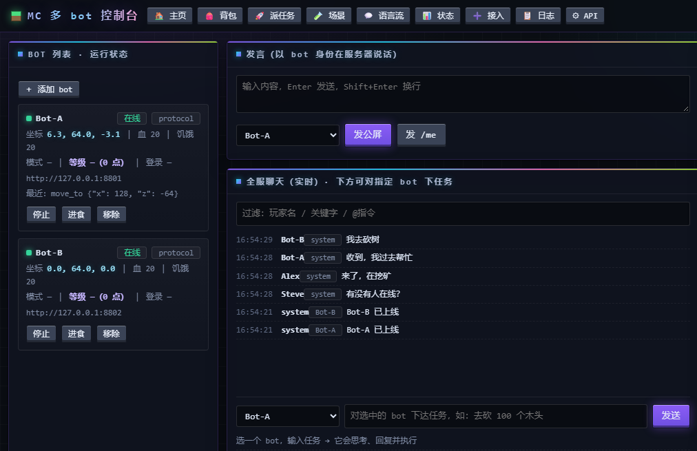

# MCBot — Minecraft 多 Bot 控制系统

一套**不启动游戏客户端**的 Minecraft 机器人系统：用 Node 协议客户端进服，用 Python 写一个统一控制台，
用一台安卓手机就能 24 小时托管，PC 与手机都能当遥控器。

> 本文档库整理的是**已经跑通的实现**（含 PC 端与手机端两套落地形态），不是设想稿。
> 所有"实测"标注均来自真实运行记录，踩过的坑逐条列在 [docs/05-经验总结.md](docs/05-经验总结.md)。

---

## 1. 一句话架构

```
   浏览器 / 手机浏览器 / WebView APK
              │  HTTP (默认 8900)
              ▼
   ┌─────────────────────────────┐
   │ console.py   控制台后端      │  纯标准库，零依赖
   │ index.html   单页前端        │
   └───┬──────────────────┬──────┘
       │ /api/act         │ /api/ai_cmd
       ▼                  ▼
 ┌───────────┐      ┌───────────┐
 │ bot 桥     │      │ brain.py  │──▶ 任意 OpenAI / Anthropic 兼容 LLM
 │ 8801/8802 │      │   8902    │
 └─────┬─────┘      └───────────┘
       │ mineflayer + minecraft-protocol（协议级，不渲染画面）
       ▼
 MC 服务器（NeoForge 1.21.1 · 离线模式 + AuthMe）
```

四个进程、四个端口，互相独立：任何一个挂了不影响其他三个。

| 端口 | 进程 | 作用 | 语言/依赖 |
|---|---|---|---|
| 8900 | `console.py` | 控制台 HTTP + 前端 | Python 标准库 |
| 8902 | `brain.py` | LLM 路由 / 意图解析 | Python 标准库 |
| 8801 | `forge-live.mjs` | 协议 bot #1 的决策桥 + bot 本体 | Node + mineflayer |
| 8802 | `forge-live.mjs` | 协议 bot #2（同代码，换端口/账号） | 同上 |

---

## 2. 快速开始（PC，5 分钟）

```bash
# 1) 依赖：Python 3.10+ / Node 18+ / Git
python --version && node --version

# 2) 装 Node 依赖（约 300–600 MB）
cd src/bot && npm install && node apply-patches.mjs

# 3) 配置账号（把示例复制成真配置，再填自己的）
cd ../../config
cp bots.example.json ../src/console/bots.json
cp brain.example.json ../src/console/brain.json
#   编辑 bots.json：服务器地址、账号、AuthMe 口令

# 4) 起服务
cd ../src/console
python console.py --port 8900          # 另开窗口：python brain.py --port 8902
```

浏览器打开 `http://127.0.0.1:8900` 即可。完整步骤（含 GUI 版、开机自启、校验点）见
[docs/01-部署流程/01-PC端部署.md](docs/01-部署流程/01-PC端部署.md)。

> ⚠️ **仓库内的 `src/bot/capture/` 是 12 条示意样本，不能连任何真实 NeoForge 服务器。**
> 连接真服前必须用与目标服务器一致的整合包抓一份通道表替换它，
> 否则会被服务端以"你没有安装 NeoForge"为由踢掉。步骤见
> [src/bot/capture/README.md](src/bot/capture/README.md)。

**只想看界面长什么样**：`python mock_bot.py` 起两个假 bot，控制台全部功能都能点，不用真服务器。

---

## 3. 仓库结构

```
mcbot-system/
├── README.md                  ← 本文件（总入口）
├── LICENSE                    MIT
├── SECURITY.md                脱敏清单 / 鉴权模型 / 合规提示
├── docs/
│   ├── 00-项目总览.md          背景 / 目标 / 演进 / 组件清单 / 里程碑
│   ├── 01-部署流程/
│   │   ├── 01-PC端部署.md      Windows 环境从零到 bot 进服
│   │   ├── 02-Termux安卓部署.md 一部安卓手机 = 服务器 + 遥控器
│   │   ├── 03-PC到手机同步更新.md 改完代码怎么推到手机
│   │   └── 04-网络与远程访问.md  Tailscale / 局域网 / 公网 + 鉴权
│   ├── 02-操作手册.md          日常启停、体检、日志、脚本速查
│   ├── 03-PC端控制台.md        架构、API、统一语义、bot 间语言、只读模式
│   ├── 04-移动端控制台.md      三种移动形态、APK 工程、性能优化
│   ├── 05-经验总结.md          ★ 27 条实测踩坑（现象/根因/解法）
│   ├── 06-协议层与NeoForge协商.md  ★ 本项目的技术核心
│   ├── 07-排错FAQ.md           按症状查
│   ├── 08-开发历程与里程碑.md
│   └── 09-手动上传指南.md      ★ 推送到 GitHub 的完整手动流程
├── src/
│   ├── console/              控制台后端 + 单页前端 + GUI/启动器
│   ├── bot/                  协议 bot 本体 + 通道样本 + node_modules 补丁
│   ├── deploy/               Termux 部署包脚本 + PC 端打包器
│   ├── android/              WebView APK 工程（Android Studio）
│   └── tools/                探针、看门狗、安全导航
├── config/                   示例配置（真实口令不入库）
├── scripts/                  Windows 一键启动 bat
└── assets/                   控制台截图
```

---

## 4. 能做什么（已实测）

| 能力 | 状态 | 说明 |
|---|---|---|
| 协议 bot 进 NeoForge 服务器 | ✅ | 上千条通道协商 + AuthMe 登录，无需游戏客户端 |
| 网页派发动作 | ✅ | 移动/挖掘/工作/跟随/说话/进食/装备，104 个原生动词 |
| 多 bot 同时在线 | ✅ | 每 bot 一个进程一个端口，控制台统一调度 |
| bot 之间互相指挥 | ✅ | 游戏内 `@bot 动词 参数`，白名单 + 目标租约 |
| 全服聊天聚合 | ✅ | 一个在线连接即可覆盖全服公屏 |
| LLM 大脑 | ✅ | 支持多提供商、余额/用量统计、规则解析兜底 |
| 背包 / 装备操作 | ⚠️ | 物品栏可见可拖拽；部分模组 GUI 操作会断线 |
| 只读模式 | ✅ | 服务端白名单拦截，给高价值 bot 接第三方时的安全阀 |
| 第三方 bot 反向接入 | ✅ | 对方跑 `reporter.py` 主动连，穿 NAT |
| 纯手机零电脑常驻 | ✅ | 安卓 Termux，关 PC 后实测仍能进服 |
| 安卓 APK 外壳 | ✅ | WebView 套壳，非 exe 转 apk |

---

## 5. 文档阅读顺序建议

- **想复现部署** → `docs/01-部署流程/01`（PC）→ `02`（手机）→ `03`（同步更新）
- **想改功能** → `docs/03-PC端控制台.md` + `docs/06-协议层与NeoForge协商.md`
- **出故障** → `docs/07-排错FAQ.md`；查不到再翻 `docs/05-经验总结.md`
- **接手维护** → 先读 `docs/00-项目总览.md` 的组件清单与 `docs/08` 的演进时间线
- **要发布到 GitHub** → `docs/09-手动上传指南.md`（含公开前脱敏检查、PAT、三条上传路线）

---

## 6. 安全与合规（必读）

1. **仓库内不含任何真实口令 / API Key / 服务器地址 / 真实玩家名**。
   `config/*.example.json` 是模板，复制后自己填；代码与脚本里的地址统一为 `mc.example.com:25565`。
   截图来自 `mock_bot.py` 演示环境（Bot-A / Bot-B）。
2. **公网暴露必须开 `CONSOLE_TOKEN`**，否则拿到 URL 的人就能指挥你的 bot。
3. 控制台监听 `0.0.0.0` 时等同于开放远程控制，推荐 Tailscale 内网而非端口映射。
4. 服务器为第三方公共服：**禁止刷屏、禁止破坏建筑（`canDig=false`）、遵守挂机规则**。
   长期挂机被判定违规的唯一实质风险是封号，取舍自负。
5. 本项目未包含任何第三方模组资源文件（物品图标等），需按 `docs/03` 说明自行获取。

详见 [SECURITY.md](SECURITY.md)。

---

## 7. 已知短板

| 短板 | 影响 | 现状 |
|---|---|---|
| `forge-live.mjs` 无单元测试 | 回归靠日志与实测 | 关键路径用 `restart.sh` 的握手自检兜底 |
| 模组 GUI（传送石碑 / 尸体 / 部分容器）打开即断线 | 部分交互用不了 | 已定位为包解析失败（0x11/0x58/0x5b），未根治 |
| 注册表条目解析丢 38%~63% 的 damage_type/enchantment | 少量属性不准 | 物品/方块/维度关键表完整，不影响主要功能 |
| 手机端后台可能被 Android 回收 | bot 掉线 | `wake-lock` + 电池白名单只能压低概率 |
| 前端 67 KB 单文件 | 手机首屏慢 | 已做图标负缓存 + HTTP/1.1 复用，首屏 ~1s |

---

## 8. 截图



> 截图为 `mock_bot.py` 演示环境（Bot-A / Bot-B），不含真实账号与服务器信息。
> 复现方式：`scripts/启动_演示模式.bat`。

---

## 9. 许可

本项目以 **MIT** 许可发布，见 [LICENSE](LICENSE)。

`src/bot/patches/` 内是对若干 MIT 许可第三方库（minecraft-protocol / mineflayer /
prismarine-nbt / prismarine-registry）的修改版完整文件，版权归各上游项目所有。

本项目不包含任何 Minecraft 客户端资源、模组文件或整合包内容；
`src/bot/capture/` 中的通道表为示意样本。Minecraft 是 Mojang Studios 的商标，
本项目与 Mojang / Microsoft 无关联。

---

## 10. 发布到 GitHub

完整手动流程（建空仓库 → 生成 PAT → 关联 remote → 推送 → 验证 → 常见报错）见
[docs/09-手动上传指南.md](docs/09-手动上传指南.md)。
推送前请务必执行该文档第 0 节的敏感信息复查。
